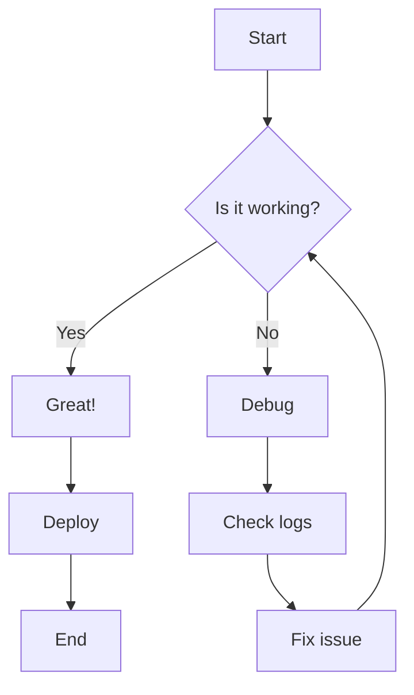
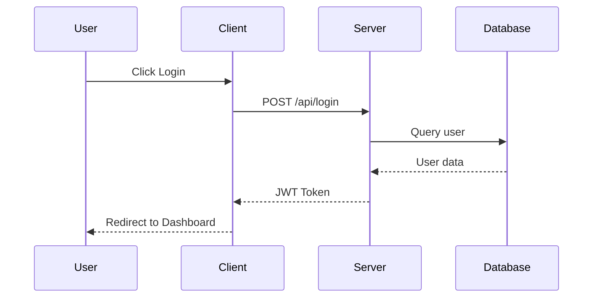
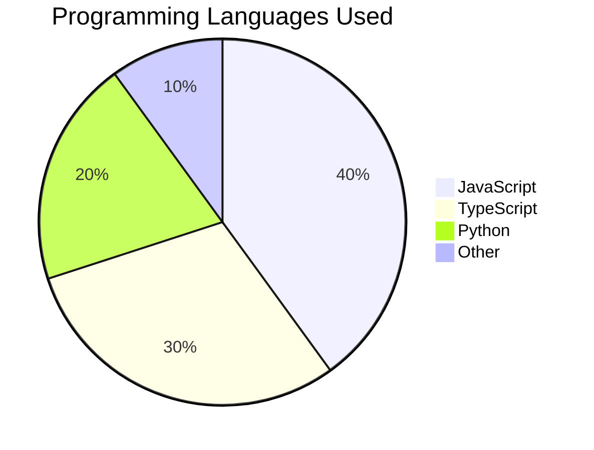
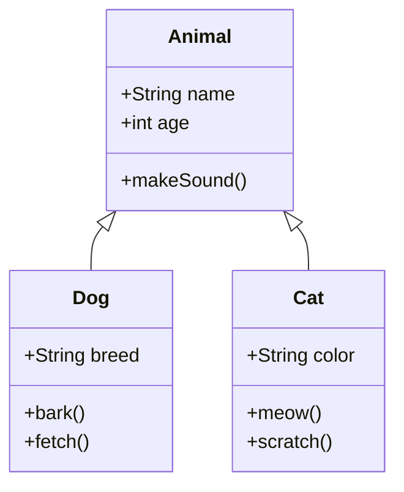
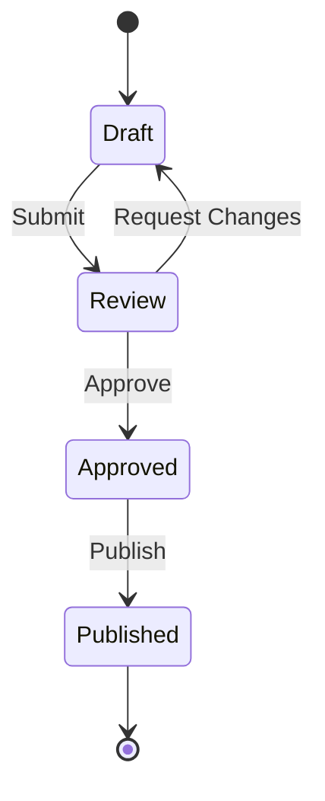
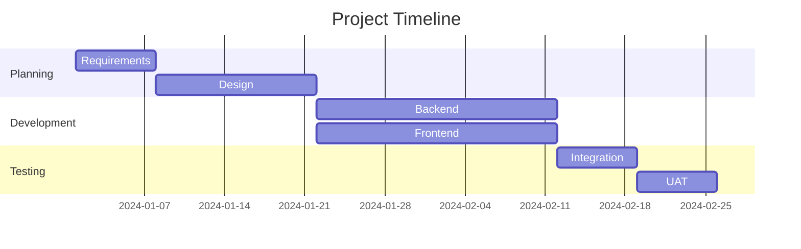

# Markdown Workbench Demo

[TOC]

This document demonstrates all the Markdown syntax supported by Markdown Workbench.

---

## Text Formatting

**Bold text** is created with double asterisks or underscores.

*Italic text* is created with single asterisks or underscores.

***Bold and italic*** can be combined.

~~Strikethrough~~ uses double tildes.

`Inline code` uses backticks.

H~2~O demonstrates subscript (water molecule).

E = mc^2^ demonstrates superscript (Einstein's equation).

More examples: CO~2~ (carbon dioxide), x^2^ + y^2^ = z^2^ (Pythagorean theorem)

---

## Links and Images

[External link](https://github.com)

[Link with title](https://github.com "GitHub Homepage")

[Relative link to README](README.md)


---

## Lists

### Unordered List

- First item
- Second item
  - Nested item
  - Another nested item
    - Deeply nested
- Third item

### Ordered List

1. First step
2. Second step
3. Third step
   1. Sub-step A
   2. Sub-step B

### Task List

- [x] Completed task
- [x] Another completed task
- [ ] Incomplete task
- [ ] Future task

---

## Blockquotes

> This is a blockquote.
> It can span multiple lines.
>
> > Nested blockquotes are also supported.
> > They can contain **formatted text**.

---

## Code Blocks

Inline code: `const greeting = "Hello, World!";`

### JavaScript

```javascript
function fibonacci(n) {
  if (n <= 1) return n;
  return fibonacci(n - 1) + fibonacci(n - 2);
}

// Calculate first 10 Fibonacci numbers
for (let i = 0; i < 10; i++) {
  console.log(`F(${i}) = ${fibonacci(i)}`);
}
```

### Python

```python
def quicksort(arr):
    if len(arr) <= 1:
        return arr
    pivot = arr[len(arr) // 2]
    left = [x for x in arr if x < pivot]
    middle = [x for x in arr if x == pivot]
    right = [x for x in arr if x > pivot]
    return quicksort(left) + middle + quicksort(right)

numbers = [3, 6, 8, 10, 1, 2, 1]
print(quicksort(numbers))
```

### TypeScript

```typescript
interface User {
  id: number;
  name: string;
  email: string;
  isActive: boolean;
}

async function fetchUser(id: number): Promise<User> {
  const response = await fetch(`/api/users/${id}`);
  return response.json();
}
```

### SQL

```sql
SELECT
    u.name,
    u.email,
    COUNT(o.id) as order_count,
    SUM(o.total) as total_spent
FROM users u
LEFT JOIN orders o ON u.id = o.user_id
WHERE u.created_at >= '2024-01-01'
GROUP BY u.id, u.name, u.email
HAVING COUNT(o.id) > 0
ORDER BY total_spent DESC
LIMIT 10;
```

### Bash

```bash
#!/bin/bash

# Backup script
BACKUP_DIR="/backups"
DATE=$(date +%Y-%m-%d)

for dir in /var/www/*; do
    if [ -d "$dir" ]; then
        tar -czf "$BACKUP_DIR/$(basename $dir)-$DATE.tar.gz" "$dir"
        echo "Backed up: $dir"
    fi
done
```

### JSON

```json
{
  "name": "markdown-workbench",
  "version": "1.0.0",
  "dependencies": {
    "react": "^18.2.0",
    "electron": "^28.0.0"
  },
  "scripts": {
    "start": "electron .",
    "build": "webpack --mode production"
  }
}
```

### YAML

```yaml
version: '3.8'
services:
  web:
    build: .
    ports:
      - "3000:3000"
    environment:
      - NODE_ENV=production
    volumes:
      - ./data:/app/data
    depends_on:
      - database

  database:
    image: postgres:15
    environment:
      POSTGRES_DB: myapp
      POSTGRES_PASSWORD: secret
```

---

## Tables

| Feature | Status | Notes |
|---------|:------:|------:|
| Markdown Preview | ✅ | Full GFM support |
| Syntax Highlighting | ✅ | 100+ languages |
| Mermaid Diagrams | ✅ | All diagram types |
| Math/LaTeX | ✅ | KaTeX rendering |
| Dark Mode | ✅ | System preference |

### Alignment Examples

| Left Aligned | Center Aligned | Right Aligned |
|:-------------|:--------------:|--------------:|
| Data | Data | Data |
| More data | More data | More data |

---

## Horizontal Rules

Three or more dashes:

---

Three or more asterisks:

***

Three or more underscores:

___

---

## Admonitions

> [!NOTE]
> This is a note admonition. Use it for general information that you want to highlight.

> [!TIP]
> This is a tip admonition. Great for sharing helpful suggestions and best practices.

> [!IMPORTANT]
> This is an important admonition. Use it for critical information users shouldn't miss.

> [!WARNING]
> This is a warning admonition. Alert users to potential issues or pitfalls.

> [!CAUTION]
> This is a caution admonition. Use for serious warnings about dangerous actions.

### MkDocs-Style Admonitions

!!! note "Custom Title"
    This is a note with a custom title using MkDocs syntax.
    It can contain multiple paragraphs.

!!! danger "Security Warning"
    Never commit secrets or API keys to version control!

    Use environment variables or secret management tools instead.

!!! tip
    Tips without a custom title use the default "Tip" heading.

---

## Mermaid Diagrams

### Flowchart



### Sequence Diagram



### Pie Chart



### Class Diagram



### State Diagram



### Gantt Chart



---

## Math/LaTeX

### Inline Math

Einstein's famous equation: $E = mc^2$

The quadratic formula: $x = \frac{-b \pm \sqrt{b^2 - 4ac}}{2a}$

Euler's identity: $e^{i\pi} + 1 = 0$

### Block Math (Display Mode)

The Gaussian integral:

$$
\int_{-\infty}^{\infty} e^{-x^2} dx = \sqrt{\pi}
$$

Maxwell's equations in differential form:

$$
\begin{aligned}
\nabla \cdot \mathbf{E} &= \frac{\rho}{\varepsilon_0} \\
\nabla \cdot \mathbf{B} &= 0 \\
\nabla \times \mathbf{E} &= -\frac{\partial \mathbf{B}}{\partial t} \\
\nabla \times \mathbf{B} &= \mu_0 \mathbf{J} + \mu_0 \varepsilon_0 \frac{\partial \mathbf{E}}{\partial t}
\end{aligned}
$$

The Schrödinger equation:

$$
i\hbar\frac{\partial}{\partial t}\Psi(\mathbf{r},t) = \left[-\frac{\hbar^2}{2m}\nabla^2 + V(\mathbf{r},t)\right]\Psi(\mathbf{r},t)
$$

A matrix:

$$
A = \begin{pmatrix}
a_{11} & a_{12} & a_{13} \\
a_{21} & a_{22} & a_{23} \\
a_{31} & a_{32} & a_{33}
\end{pmatrix}
$$

---

## Footnotes

Here is a sentence with a footnote reference.[^1]

Another statement that needs a citation.[^citation]

Technical terms can have footnotes too.[^technical]

[^1]: This is the first footnote. It appears at the bottom of the document.

[^citation]: Footnotes are great for citations without cluttering the main text.

[^technical]: Footnotes can contain **formatted text**, `code`, and even [links](https://example.com).

---

## Emoji Shortcodes

### Common Emoji

:smile: :laughing: :heart: :star: :fire: :rocket: :tada:

:thumbsup: :thumbsdown: :clap: :pray: :muscle:

:warning: :x: :white_check_mark: :question: :exclamation:

:bulb: :memo: :book: :bookmark: :link:

:bug: :wrench: :hammer: :gear: :lock: :key:

### Emoji in Context

:rocket: Launch day is here! :tada:

:warning: **Warning:** This action cannot be undone :x:

:bulb: **Tip:** Use keyboard shortcuts for faster navigation :zap:

:heart: Thanks for using Markdown Workbench! :star:

---

## HTML Elements

HTML is supported for advanced formatting:

<details>
<summary>Click to expand hidden content</summary>

This content is hidden by default.

- It can contain lists
- And **formatted text**
- And even `code`

</details>

<kbd>Ctrl</kbd> + <kbd>S</kbd> to save

<mark>Highlighted text</mark> stands out.

Text with <sup>superscript</sup> and <sub>subscript</sub> using HTML.

<div align="center">

**Centered content using HTML**

</div>

---

## Escaping Special Characters

Use backslash to escape special Markdown characters:

\*Not italic\*

\# Not a heading

\[Not a link\](url)

\`Not code\`

---

## Combining Features

Here's an example combining multiple features:

> [!TIP]
> **Pro tip:** You can combine features for powerful documentation!
>
> For example, use math in tables:
>
> | Formula | Result |
> |---------|--------|
> | $2^{10}$ | 1024 |
> | $\sqrt{144}$ | 12 |
>
> Or add :emoji: and `code` in admonitions! :rocket:

---

## Conclusion

This demo showcases the full range of Markdown syntax supported by Markdown Workbench. Use these features to create rich, well-formatted documentation!

:star: **Happy writing!** :star:
